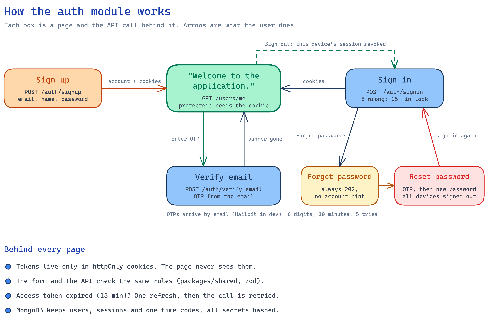
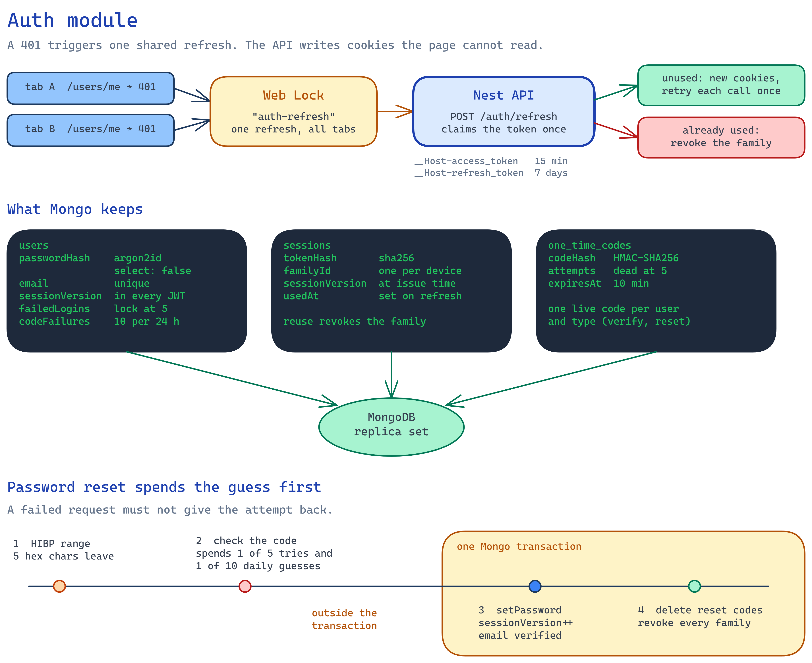

# Application

Application (repo: `auth-module`). Sign up, sign in and a protected welcome page, plus email verification and password reset with one-time codes, built with **NestJS 12 + MongoDB** and **React 19 + TypeScript**. How AI was used, and every decision behind it, is in [AI.md](AI.md).

```
apps/api         NestJS API (auth, users, sessions, mail)
apps/web         React app (Vite, Tailwind, shadcn/ui)
packages/shared  zod schemas and password rules used by BOTH apps
```

## Quick start

**You need:** Node.js 24 and Docker.

```bash
npm ci
docker compose up -d                       # MongoDB (replica set) + Mailpit
cp apps/api/.env.example apps/api/.env     # then set JWT_ACCESS_SECRET (see the file)
```

Run the API and the web app, each in its own terminal:

```bash
npm run dev -w @auth-module/api            # http://localhost:3001
```

```bash
npm run dev -w @auth-module/web            # http://localhost:5173
```

| Open | For |
|---|---|
| http://localhost:5173 | the app |
| http://localhost:8025 | **Mailpit**, the inbox that catches every email (verification and reset codes) |
| http://localhost:3001/api/docs | Swagger / OpenAPI |

**Try it:**
1. Sign up. You land on **"Welcome to the application."** with a banner.
2. **Enter OTP**, using the code from Mailpit. The banner disappears.
3. **Sign out**, then **Forgot password?** and enter your email.
4. Enter the OTP from Mailpit, **Confirm**, choose a new password, **Reset password**. You are sent to sign in, and every other device is signed out.

## Scripts (from the repo root)

| Command | Does | In CI |
|---|---|---|
| `npm run lint` | oxlint | ✅ |
| `npm run typecheck` | `tsc` in every package | ✅ |
| `npm test` | unit and integration tests: shared, API (in-memory Mongo replica set), web (real route table, network mocked) | ✅ |
| `npm run build` | builds shared, API and web | ✅ |
| `npm run test:e2e` | Playwright in Chromium against the running stack. Needs `docker compose up`; starts the API and web dev servers if they aren't running. First time: `npx playwright install chromium` | no, it needs Docker and Mailpit |

CI is `.github/workflows/ci.yml`, on every push and pull request.

## Features

- **Sign up**: email, name (3 or more characters), password (8 or more characters, with a letter, a number and a special character). The same zod schema validates the form and the API.
- **Sign in / sign out**: sessions in httpOnly cookies. Sign out revokes the session on the server.
- **Protected page**: the welcome page, backed by `GET /api/users/me`.
- **Email verification**: a 6-digit OTP emailed at sign-up, entered in the app. You can resend it.
- **Password reset**: request an OTP, enter it, then choose a new password. **Every device is signed out.**

## API

| Method | Path | Access |
|---|---|---|
| POST | `/api/auth/signup`, `/signin` | public |
| POST | `/api/auth/refresh`, `/logout` | refresh cookie |
| POST | `/api/auth/verify-email`, `/verify-email/resend` | signed in |
| POST | `/api/auth/forgot-password` | public, **always 202** |
| POST | `/api/auth/reset-password` | public |
| GET | `/api/users/me` | signed in (the protected endpoint) |
| GET | `/api/health` | public |

Every route requires a session unless it is marked `@Public()`: a global guard checks the access cookie and its `sessionVersion`.

Errors are [RFC 9457](https://www.rfc-editor.org/rfc/rfc9457) problem details. Validation errors carry `errors: [{ path, message }]`, which the web app shows under the matching field.

## System design

Tokens stay in two httpOnly cookies. `apps/web` posts to `/api` with `credentials: 'include'`. The Nest API sets `__Host-access_token` (15 min) and `__Host-refresh_token` (7 days), and `AuthService` decides lockout, rotation and one-time codes. Three collections live in one MongoDB replica set: users, sessions and one-time codes. Mail and the Have I Been Pwned range API sit outside the API: sign-up doesn't wait for mail, and the breached-password check fails open.



The flow above is what a user does and which API call each page makes. The drawing below goes one level deeper, in three parts: how a request refreshes, what Mongo stores, and the order of a password reset.



**Request and refresh.** React calls the API, and the API writes the cookies; page scripts can't read them. When a protected call gets a 401, the web app refreshes once and retries. Every caller in that moment, in every tab, shares that one refresh (a Web Lock spans the tabs). A second presentation of the same refresh token revokes the whole family.

**What Mongo stores.** The user document keeps an argon2id hash (`select: false`), a `sessionVersion`, and the counters behind the limits: wrong passwords and the lock, and wrong codes in the last 24 hours. A session row keeps the sha256 of the refresh token and the `sessionVersion` it was issued under, so a token from before a reset can't be exchanged. A code row keeps an HMAC of the 6-digit code. Five wrong attempts kill that code. Ten wrong codes per account per day cap guessing that works by asking for a fresh code.

**Reset order.** The breached-password check runs first, so a rejected password leaves the code unused. The code is then checked outside any transaction, so the attempt stays spent even if the request fails. After that, one transaction saves the new hash, bumps `sessionVersion`, marks the email verified, deletes reset codes and revokes every session family.

## Security design

**Sessions**
- **httpOnly cookies only.** JavaScript never sees a token: `__Host-access_token` (JWT, 15 min) and `__Host-refresh_token` (opaque, 7 days), both `Secure` and `SameSite=Strict`. The `__Host-` prefix stops a sibling subdomain from planting cookies.
- **Refresh-token rotation with reuse detection.** Every refresh issues a new token. Presenting an already-used token revokes that whole session family, because it means the token was copied.
- **`sessionVersion`**: access tokens and session rows carry the user's version. A password reset bumps it, which kills all access *and* refresh tokens at once.

**Passwords and sign-in**
- **Hashing:** argon2id.
- **Breached passwords:** checked against Have I Been Pwned. Only 5 characters of the SHA-1 leave the server, and the check fails open.
- **Lockout:** 5 wrong passwords lock the account for 15 minutes, on top of per-IP rate limiting. The response stays the generic "Invalid email or password", so neither it nor its timing reveals whether an account exists.

**One-time codes**
- **Format:** 6 digits, 10-minute expiry, **5 wrong attempts and the code is dead**.
- **Daily budget:** at most 10 wrong codes per account per 24 h, across every code issued. Requesting fresh codes doesn't buy more guesses.
- **Reserve, then verify:** sign-in attempts and code checks are counted atomically *before* comparing, so parallel requests can't race past the limits.
- **Storage:** HMAC'd with a server-side key. Plain hashes of a 6-digit code could be reversed instantly from a leaked database.
- **Attempt counting:** atomic, and outside any transaction, so an aborted request can't roll back a wrong guess.

**Account discovery**
- Forgot-password always answers 202 and does its work after responding.
- Reset gives the same error for an unknown email as for a wrong code.
- Emails sent to unverified addresses contain no user-supplied text.

**Platform**
- **Built into NestJS 12:** security headers (`useSecurityHeaders()`), CSRF protection (`enableCsrfProtection()`, Fetch Metadata), and cookie handling.
- **Password reset is one Mongo transaction:** new hash, `sessionVersion++`, email verified, reset codes deleted, sessions revoked.

## Testing

| Layer | What | Where |
|---|---|---|
| **Unit** | shared schemas and password rules (table-driven); the OTP service against a real in-memory Mongo (HMAC storage, single use, 5-attempt limit, expiry, parallel races); the breach check; the web's theme store and form-error helpers | `packages/shared/src/*.test.ts`, `apps/api/src/**/*.test.ts`, `apps/web/src/lib/*.test.ts` |
| **Integration** | **API:** every endpoint over HTTP with supertest against a real `MongoMemoryReplSet`, mail and the breach check replaced by fakes, codes read from the recorded mail. **Web:** Testing Library rendering the real route table with only `lib/api.ts` mocked: forms, guards, the OTP input, the resend countdown, the two reset steps, show/hide password | `apps/api/test/`, `apps/web/src/**/*.test.tsx` |
| **End-to-end** | Playwright in Chromium against the real web, API, Mongo and Mailpit: sign up, verify with the OTP from Mailpit, check the session is httpOnly-only, sign out, reset (a wrong OTP, then the right one), the old password fails and the new one works; plus guards and 404 | `e2e/` |

**Pinned tests** guard the security decisions above. Each was checked by temporarily breaking the protection it covers and watching exactly that test fail.

## Known trade-offs

| Decision | Why |
|---|---|
| Signup returns **409** for a taken email | It reveals that the account exists. Accepted for a clearer sign-up; forgot-password and sign-in don't leak this. |
| Unverified users can use the app | Verification shows a banner instead of blocking, so sign-up works without an inbox. Gate features on `emailVerified` when one needs a proven address. |
| Minimum password length **8** | The task's spec. NIST 800-63B rev 4 suggests 15 for single-factor passwords. The breach check covers much of the gap. |
| Lockout can be triggered by someone else | It lasts only 15 minutes, and a password reset lifts it immediately. |
| Rate limits are kept in memory, per instance | Enough for one instance. Lockout and code attempts are stored in Mongo, so they already work across instances. Use Redis or Mongo throttler storage to scale out. Behind a reverse proxy, set `TRUST_PROXY=1` so the limits see the client's IP, not the proxy's. |
| Per-IP throttling is off in e2e tests | All test traffic comes from one IP. Per-account limits (lockout, code attempts) stay fully tested. |
| Swagger is served in every environment | Handy for reviewing this project. For a public deployment, mount it only outside production. |
